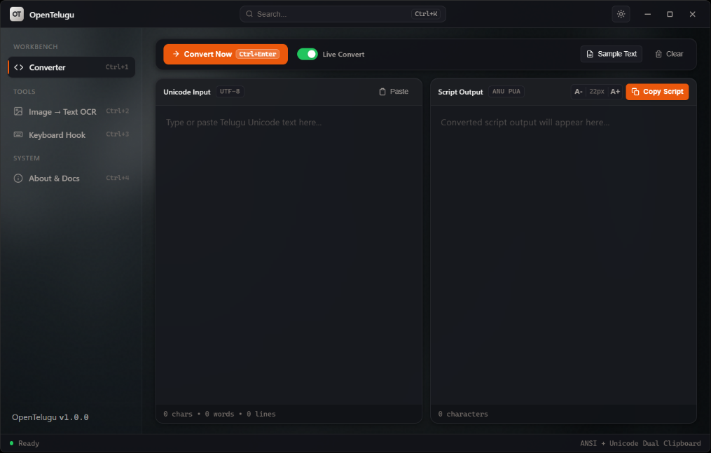
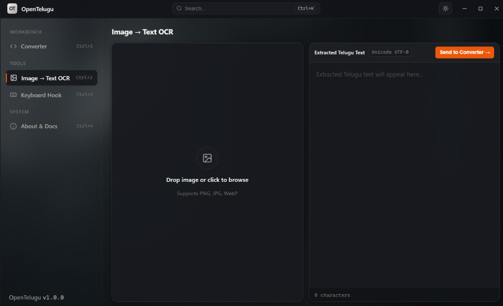
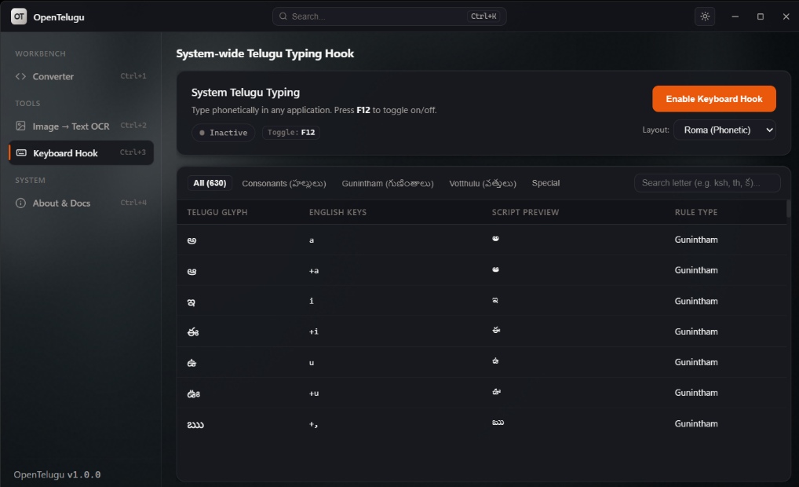

<div align="center">

# OpenTelugu

**The modern Telugu typesetting workbench for Adobe InDesign, Photoshop, and PageMaker.**

Zero-latency Unicode ligature conversion, system-wide physical typing hook, and embedded neural OCR—packaged in a 17 MB native Windows desktop workstation.

<br />

[](https://github.com/weslyjohn1307/Opentelugu/releases)
[](https://github.com/weslyjohn1307/Opentelugu/releases)
[](https://www.rust-lang.org)
[](https://tauri.app)
[](./PRIVACY.md)
[](./LICENSE)

<br />
<br />

<picture>
  <source media="(prefers-color-scheme: dark)" srcset="./docs/screenshots/converter-dark.png">
  <source media="(prefers-color-scheme: light)" srcset="./docs/screenshots/converter-light.png">
  
</picture>

<sub>*Dynamic Theme Engine: High-contrast Obsidian Dark for evening editing &bull; Tactile Alabaster Paper Light Mode for daylight typography.*</sub>

<br />
<br />

[Features](#key-capabilities) &bull; [InDesign Quickstart](#quick-start-with-indesign) &bull; [OCR Studio](#1-offline-image-to-text-ocr-studio) &bull; [Keyboard Hook](#2-system-wide-keyboard-hook) &bull; [Comparison](#why-opentelugu-outclasses-legacy-tools) &bull; [Downloads](#downloads) &bull; [Architecture](./docs/ARCHITECTURE.md) &bull; [Legal Policies](./LEGAL.md)

</div>

---

## Why OpenTelugu?

Telugu desktop publishing across India relies heavily on legacy font standards (Anu, Shree-Lipi, Priyanka, Modular) inside Adobe InDesign, Photoshop, and PageMaker. However, almost all incoming content today arrives in modern Unicode from WhatsApp, websites, email, and Word documents.

Pasting Unicode directly into legacy DTP fonts produces broken glyphs, missing sub-consonants (*vatthulu*), and displaced vowel signs (*kombulu*):

```diff
- UNICODE IN LEGACY INDESIGN:   నమస్కారం  ──►  Broken glyphs, detached sub-consonants (వత్తులు), displaced vowel signs
+ OPENTELUGU CONVERTED STREAM:  qeTkÍØsÁ+  ──►  100% authentic conjunct ligatures in Anu 7.0, Shree-Lipi & Priyanka
```

OpenTelugu bridges this gap with sub-millisecond compiled Rust conversion, dual-clipboard injection, and system-wide keyboard hooks.

---

## Key Capabilities

### 1. Offline Image to Text (OCR Studio)

<table>
  <tr>
    <td width="58%" align="center">
      
    </td>
    <td width="42%" valign="top">
      <h4>Local Neural OCR Studio</h4>
      <p>Extract Telugu text directly from scanned book pages, old print documents, and screenshots without uploading anything to the internet.</p>
      <ul>
        <li><strong>Drag-and-Drop & Clipboard:</strong> Paste images directly from Windows Snipping Tool (<kbd>Ctrl</kbd> + <kbd>V</kbd>) or drag files onto the drop-zone.</li>
        <li><strong>Neural LSTM Engine:</strong> Powered by standalone Tesseract 5 with Google's official Telugu trained models.</li>
        <li><strong>One-Click Pipeline:</strong> Click <em>Send to Converter</em> to push extracted text straight to the DTP output buffer.</li>
        <li><strong>Zero Cloud Egress:</strong> 100% on-device CPU inference. No API keys, no subscriptions.</li>
      </ul>
    </td>
  </tr>
</table>

---

### 2. System-Wide Keyboard Hook

<table>
  <tr>
    <td width="58%" align="center">
      
    </td>
    <td width="42%" valign="top">
      <h4>Direct In-App Typing</h4>
      <p>Type authentic Telugu script directly in Adobe InDesign, Photoshop, Word, or any Windows application without copy-pasting.</p>
      <ul>
        <li><strong>Global Toggle (<kbd>F12</kbd>):</strong> Turn typing on and off instantly without switching active windows.</li>
        <li><strong>Searchable Keystroke Directory:</strong> 630+ visual phonetic rules covering consonants, <em>gunintham</em>, and <em>vatthulu</em>.</li>
        <li><strong>4 Standard DTP Layouts:</strong> Roma (Phonetic), Apple Typewriter, Modular, and DOE (InScript).</li>
        <li><strong>Recursion Guard:</strong> Native Win32 event stamping prevents synthetic keystrokes from looping.</li>
      </ul>
    </td>
  </tr>
</table>

---

## Quick Start with InDesign

1. Open **OpenTelugu** and paste your Telugu Unicode text into the input box.
2. Click **Convert Now** (or press <kbd>Ctrl</kbd> + <kbd>Enter</kbd>).
3. Switch to **Adobe InDesign**, draw a text frame, and paste (<kbd>Ctrl</kbd> + <kbd>V</kbd>).
4. Select the pasted text and change the font to your installed Telugu font (e.g. `Anu`, `Shree`, `Priyanka`). The text will render with authentic typography and accurate conjunct ligatures.

> [!TIP]
> **Dual Clipboard Injection:** Every conversion automatically copies both 8-bit ANSI (`CF_TEXT` for InDesign/PageMaker) and UTF-16 Unicode (`CF_UNICODETEXT` for modern web browsers) to Windows memory simultaneously.

---

## Why OpenTelugu Outclasses Legacy Tools

| Capability | OpenTelugu | Legacy Web Converters | Generic Typing Tools |
| :--- | :---: | :---: | :---: |
| **Ligature Shaping Fidelity** | **100% (Zero broken glyphs)** | Broken *Vatthulu* | Displaced Vowels |
| **Direct In-App Typing (<kbd>F12</kbd>)** | **Native Win32 Hook** | None (Copy/Paste only) | Partial |
| **Offline Neural OCR** | **Embedded Tesseract 5** | Requires Web Upload | None |
| **Dual Clipboard Injection** | **`CF_TEXT` + `CF_UNICODETEXT`** | Single format | Single format |
| **Data Privacy & Security** | **100% Offline (Zero Egress)** | Server Logged | Cloud Telemetry |
| **Binary Footprint** | **~17 MB (Tauri v2 + Rust)** | Browser / Heavy Electron | ~150 MB+ |

---

## Supported Keyboard Layouts

Choose the layout that matches your typing habits:

- **Roma (Phonetic)**: Natural English transliteration (`ka` &rarr; క, `kaa` &rarr; కా, `namaskaram` &rarr; నమస్కారం).
- **Apple Layout**: Familiar mechanical Telugu typewriter arrangement.
- **Modular Layout**: Standard layout used in Indian DTP press environments.
- **DOE (InScript)**: Official Indian government standard keyboard layout.

<details>
<summary><strong>⌨️ View Quick Roma (Phonetic) Transliteration Cheat Sheet</strong></summary>

<br />

| Telugu Glyph | English Keystroke | Glyph Type | Example |
| :---: | :---: | :---: | :---: |
| **అ** | `a` | Vowel | `amma` &rarr; అమ్మ |
| **ఆ** | `aa` / `A` | Vowel | `aakaasam` &rarr; ఆకాశం |
| **క** | `ka` | Consonant | `kala` &rarr; కల |
| **కా** | `kaa` | Gunintham | `kaaki` &rarr; కాకి |
| **క్ర** | `kra` | Vatthu | `kramam` &rarr; క్రమం |
| **క్ష** | `ksha` | Conjunct | `kshamapana` &rarr; క్షమాపణ |
| **జ్ఞ** | `jnya` | Conjunct | `jnaanam` &rarr; జ్ఞానం |

</details>

---

## Downloads

Download the latest release for Windows (64-bit):

| Download | Description | Size |
| :--- | :--- | :--- |
| **[OpenTelugu Setup (Installer)](https://github.com/weslyjohn1307/Opentelugu/releases/latest)** | Recommended Windows installer with Start Menu shortcuts | ~34 MB |
| **[OpenTelugu Portable (.exe)](https://github.com/weslyjohn1307/Opentelugu/releases/latest)** | Standalone executable, no installation required | ~17 MB |

**System Requirements:** Windows 10 or Windows 11 (64-bit).

---

<details>
<summary><strong>🛠️ Building from Source (Developers)</strong></summary>

<br />

### Prerequisites
- [Rust](https://rustup.rs/) (1.85+)
- [Node.js](https://nodejs.org/) (18+)

### Build Steps
```powershell
# 1. Clone repository
git clone https://github.com/weslyjohn1307/Opentelugu.git
cd Opentelugu

# 2. Run unit & ligature regression tests
cd src-tauri
cargo test

# 3. Launch the desktop application
cargo run
```

</details>

---

## Technical Architecture

OpenTelugu is built as a high-performance native desktop application:
- **Core Engine (Rust)**: High-speed Unicode ligature parsing, state-machine reordering, and Win32 low-level keyboard hook management.
- **Frontend (HTML / Vanilla CSS / JavaScript)**: Clean editorial UI with dual themes, subtle paper grain textures, and zero heavyweight web dependencies.
- **OCR Subsystem**: Local Tesseract 5 runtime execution communicating over native stdio pipes.

For complete system threading, memory boundaries, and clipboard specifications, see [docs/ARCHITECTURE.md](./docs/ARCHITECTURE.md).

---

## Legal & Interoperability

- **Interoperability Safe Harbor**: OpenTelugu is an independent clean-room project designed for format interoperability under **Section 52(1)(ab)** of the Indian Copyright Act, 1957 and **17 U.S.C. § 1201(f)** of the United States Code. See [LEGAL.md](./LEGAL.md).
- **No Font Software Included**: OpenTelugu does not bundle or distribute any proprietary third-party font binaries (`.ttf` / `.otf`). Users use their own legitimately installed fonts.
- **Trademark Notice**: All product names, logos, and brands (such as Adobe InDesign, Anu, Shree-Lipi) are property of their respective owners and are mentioned strictly for technical compatibility purposes. See [TRADEMARKS.md](./TRADEMARKS.md).
- **Privacy Guarantee**: 100% offline with zero cloud telemetry. See [PRIVACY.md](./PRIVACY.md).

---

## License

OpenTelugu is open-source software licensed under the [MIT License](./LICENSE).
